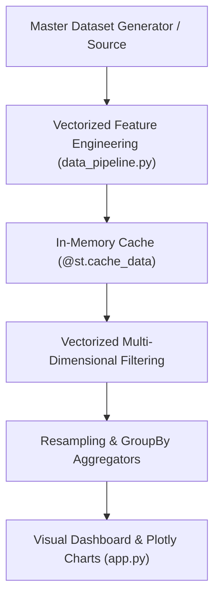

# 📖 SalesPulse Mentorship Journal & Data Architecture Lessons

A comprehensive record of the data engineering, software architecture, UI/UX design, and defensive Pandas techniques developed during Project 2: SalesPulse.

---

## 📑 Table of Contents
1. [Session 1: High-Performance Data Architecture & The Pipeline Pattern](#session-1-high-performance-data-architecture--the-pipeline-pattern)
2. [Session 2: Interactive Scenario Modeling & Defensive Engineering](#session-2-interactive-scenario-modeling--defensive-engineering)
3. [Summary of Core Engineering Patterns](#summary-of-core-engineering-patterns)

---

## Session 1: High-Performance Data Architecture & The Pipeline Pattern

### 1. The Data Pipeline Pattern (Separation of Concerns)
In professional data applications, mixing data generation, cleaning, aggregations, and visual rendering into a single monolithic file creates unmaintainable code.

We decoupled the system into two distinct layers:
* **`data_pipeline.py` (Domain Engine)**: Pure Pandas and NumPy. Zero imports from Streamlit. Responsible for generating the master dataset, parsing dates, calculating profit margins, and computing resampled time-series aggregations.
* **`app.py` (Presentation Layer)**: Pure Streamlit and Plotly. Responsible solely for filter inputs, executive scorecards, interactive charts, and user controls.



### 2. High-Performance Caching (`@st.cache_data`)
* **The Reactive Gotcha**: Streamlit executes the entire script from top to bottom every time a user changes a filter, slides a date range, or checks a box.
* **The Solution**: By decorating `get_master_dataset()` with `@st.cache_data`, Streamlit memoizes the master DataFrame in RAM. On subsequent filter runs, Streamlit fetches the dataset from memory in **under 0.1 milliseconds** instead of regenerating or reloading it from disk.

### 3. Vectorization vs. Python Loops
* Traditional Python loops (`for row in df.iterrows(): ...`) are an anti-pattern in data engineering because they run in slow interpreted Python bytecode.
* **Vectorized Operations** execute compiled C-level SIMD operations across contiguous blocks of computer memory:
```python
df["profit_margin_pct"] = np.where(
    df["sales"] > 0,
    np.round((df["profit"] / df["sales"]) * 100, 2),
    0.0,
)
```

### 4. Executive UI/UX Design: Visual Hierarchy
* **Executive KPI Scorecards**: Using `st.metric(label, value, delta)` gives decision-makers instant context (e.g., `+14.2% vs H1`).
* **Time-Series Resampling**: Allowing users to toggle between Weekly (`'W'`) and Monthly (`'ME'`) granularity on the fly without database roundtrips.

---

## Session 2: Interactive Scenario Modeling & Defensive Engineering

### 1. The "What-If" Simulation Business Case
Executives rarely just want retrospective historical reports; they need **forward-looking decision support**:
> *"If we increase base prices by +5% and cut customer discounts by -2%, what is our projected Revenue, Profit, and Margin across our active filter slice?"*

### 2. Defensive Data Engineering Patterns
When implementing `simulate_pricing_scenario`, we applied three defensive programming techniques:

#### A. Immutability & Side-Effect Prevention
```python
sim_df = df.copy()
```
In Python, DataFrames are passed by reference. Failing to copy `df` would mutate the master dataset in memory, corrupting all other charts on the dashboard.

#### B. Zero-Division Guarding (`np.where`)
```python
sim_df["gross_sales"] = sim_df["sales"] / np.where(
    sim_df["discount_pct"] < 100,
    (1 - sim_df["discount_pct"] / 100),
    1.0,
)
```
If an item has a $100\%$ discount, `(1 - 100/100) = 0`. Without guarding the denominator, this throws a `ZeroDivisionError` or creates `inf` floats.

#### C. Domain Bounding (`np.clip`)
```python
sim_df["new_discount_pct"] = np.clip(sim_df["discount_pct"] + discount_change_pct, 0.0, 100.0)
```
Prevents discounts from slipping below $0.0\%$ (which would accidentally charge the customer a penalty discount) or exceeding $100.0\%$.

### 3. The Negative Delta Business Logic
In `app.py`:
```python
df_sim = simulate_pricing_scenario(df_filtered, price_change_pct=price_adj, discount_change_pct=-disc_adj)
```
Because the slider is labeled **"Discount Reduction"**, a positive slider value (+2%) means *subtracting* discount points. Negating `-disc_adj` ensures mathematical alignment with user intent.

### 4. Percentage Points vs. Percentage Growth
In business reporting:
* Revenue growth is a percentage of the base: `((sim_rev - base_rev) / base_rev) * 100`.
* Profit margin change is measured in **percentage points (`pts`)**: `sim_margin - base_margin` (e.g., jumping from $20\%$ to $25\%$ is $+5$ percentage points).
